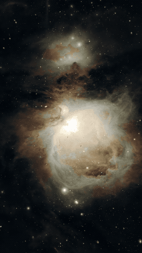
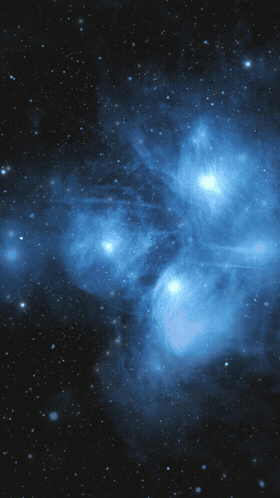

<p align="center"></p>

**English** · [Deutsch](README.de.md)

# AstroMotion

**Turn your astrophotograph into a calm flight through the stars.** StarNet2 separates stars from nebulosity. Stars from the photo move at individual depths in front of a gently moving background. The recommended setup creates a **30-second video with a seamless loop and randomly generated ambient music**. Motion, format, duration and music are configurable.

## TL;DR – get started on Windows

1. Install **Python 3.11+** (recommended: 3.12), **FFmpeg with FFprobe**, and the official [StarNet2 CLI](https://starnetastro.com/cli-tools/starnet/). FFmpeg and FFprobe must be on your PATH.
2. Clone the repository or extract it completely, then run **`setup.bat`**. It creates or reuses `.venv` and installs all dependencies.
3. Run this command from the repository folder:

```powershell
.\.venv\Scripts\python.exe main.py --input examples\real\pleiades.jpg --starnet "C:\Program Files\StarNet2\bin\starnet2.exe" --config configs\immersive_loop.yaml --output Pleiades_video.mp4
```

Replace the path after `--input` with your own photo.

## Guided launcher

On Windows, double-click **`start_wizard.bat`** or drag a photo onto it. Alternatively:

```powershell
.\.venv\Scripts\python.exe wizard.py
```

The wizard begins with a **language choice: English (`en`) or Deutsch (`de`)**. English is the default on first use; your choice is saved and offered as the default next time. To skip the language question, run `start_wizard.bat --language en` or `start_wizard.bat --language de`. On Linux/macOS, use `python wizard.py --language en` or `python wizard.py --language de`.

On the first run, the wizard asks for the **StarNet2 executable**, **photo folder**, **video folder**, and **FFmpeg/FFprobe**. After that, you can enter just a filename from the saved photo folder or a full image path. Existing saved paths and video preferences remain usable when switching languages.

For each video, choose a star-flight profile, duration, FPS, resolution, format, seamless loop, title, subtitle and music style. **Press Enter to accept a default**; video preferences are saved for the next run. Titles and subtitles are entered separately for each photo. `-` clears an optional field. Use music style `random` and seed `random` (`zufall` in German) for fresh arrangements. Yes/no prompts use `y/n` in English and `j/n` in German; both forms are accepted. Profile names, music styles and configuration values stay the same in both languages.

An optional menu controls background zoom, rotation, lateral star motion, star count, brightness, loop pace, volume and text size. Before rendering, the wizard shows your choices and asks whether to start. Replacing an existing video requires explicit confirmation.

Choose **`preview`** as the render mode for a **360p preview with the same duration, FPS, loop and animation settings** as the full video (360 × 640 vertically). The preview adds `_preview` to the selected video filename. Afterwards, the wizard offers to render the full-resolution video with the same random motion variation and music arrangement. Preview mode keeps your saved full-video resolution. StarNet2 runs once; the full export reuses its checked working-size output from the preview's `_assets` folder.

If you decline the full export, **Make adjustments?** reopens the wizard for the same photo with all preview values prefilled, including title, subtitle, output filename and the resolved motion/music seeds. Edit any value and render another preview; Enter keeps the current value and `-` clears optional text. The checked StarNet2 cache is reused, including when you choose a different output filename. After each preview you can export the full video or adjust again.

Keep that folder to reuse the separation, including on a later full export with the same video filename. The cache checks the source photo, working pixels/size, StarNet2 settings, executable/model files and output checksum. A missing, changed or damaged cache causes a fresh genuine StarNet2 run. Repeating a render can also reuse its own `_assets` cache. `render_report.json` records whether the cache was used. For separate CLI exports, append `--starnet-cache "photo_preview_assets"` while keeping your StarNet2 executable configured; `--starless` remains for original-size externally separated images.

The wizard remembers the **five most recent distinct setups from successful previews or video renders**, newest first. After choosing a photo, select a recent template or `0` for the current defaults, then adjust any setting in the normal menus. Reusing a setup moves it to the top. Titles and subtitles are entered afresh for each photo; paths come from your current setup. Dry runs, cancelled launches and failed renders do not add a history entry.

Direct preview start: `start_wizard.bat --preview` or `python wizard.py --preview`. Use `--no-preview` to skip the mode question and render at the chosen full-video resolution. The command-line launcher also supports `main.py --preview` with full duration and FPS; separate CLI runs need the same `--profile-seed` and music `--seed` if you want to repeat their random choices.

Update saved paths: `start_wizard.bat --setup`. Check settings without rendering: `start_wizard.bat --dry-run`. On Linux/macOS, run `python wizard.py` with the project environment activated.

Local settings are stored in `.astromotion-wizard.json`, which Git ignores. The wizard uses the same StarNet2 pipeline and Python interpreter as the command-line launcher.

## Demos

My own photos, captured with **Seestar S50 Pro** and processed with **AstroWizard**. You may use the included photos and demo media.

| Orion Nebula · M42 | Pleiades · M45 |
|---|---|
| [](examples/real/orion_starnet_demo.mp4) | [](examples/real/pleiades_starnet_demo.mp4) |
| [Original photo](examples/real/orion.jpg) · [Video with music](examples/real/orion_starnet_demo.mp4) | [Original photo](examples/real/pleiades.jpg) · [Video with music](examples/real/pleiades_starnet_demo.mp4) |

Each video is 30 seconds, 1080 × 1920, 30 FPS, H.264/AAC. GIFs are silent previews with a reduced color palette; open the MP4s to assess image quality and hear the music.

## Installation

### Windows

`setup.bat` uses the same interpreter as `start_windows.bat`: **`.venv\Scripts\python.exe`**. It reuses an existing project environment, installs `requirements.txt`, checks package imports, and stops with a clear message if something fails. `setup_windows.bat` remains available as an alternative entry point.

For manual installation, skip the first line if `.venv` already exists:

```powershell
py -3 -m venv .venv
.\.venv\Scripts\Activate.ps1
python -m pip install -r requirements.txt
```

If PowerShell blocks activation, install directly with the project interpreter and use that interpreter to launch AstroMotion as well:

```powershell
.\.venv\Scripts\python.exe -m pip install -r requirements.txt
```

### Linux / macOS

Install Python 3.11+, `venv`, FFmpeg/FFprobe, and the official StarNet2 CLI package for your platform.

```bash
python3 -m venv .venv
source .venv/bin/activate
python -m pip install -r requirements.txt
python main.py --input examples/real/pleiades.jpg --starnet "/path/to/starnet2" --config configs/immersive_loop.yaml --output Pleiades_video.mp4
```

If necessary, make the StarNet2 executable runnable with `chmod +x /path/to/starnet2`.

## Customize your video

Start with **[`configs/immersive_loop.yaml`](configs/immersive_loop.yaml)**. This setup provides the main effect shown in the demos: individual star flight, calm background movement and a seamless loop, without additional visual effects.

Append these options to your launch command:

| Goal | Option |
|---|---|
| Star-flight profile | `--profile relax`, `drift` or `explore` |
| Ambient style | `--music-style random`, `warm`, `deep`, `shimmer`, `pulse` or `classic` |
| Longer, slower loop video | `--duration 45` |
| More even background zoom and rotation | `--camera-timing steady` |
| Continuous forward camera movement | `--camera-timing steady --no-loop` |
| Landscape / square format | `--format landscape` / `--format square` |
| Resolution | `--resolution 360p`, `720p`, `1080p` or `4k` |
| 360p preview with full duration and FPS | `--preview` |
| Frame rate | `--fps 24`, `30` or `60` |
| Softer star colors | `--star-color-strength 0.6` |
| Repeat the same music variation | `--seed 1234` |
| Your own music / no audio | `--audio "music.wav"` / `--music none` |
| Display an object name | `--title "Pleiades"` |
| Add a second line of text | `--subtitle "MESSIER 45"` |
| Disable looping | `--no-loop` |
| Replace an existing output file | `--overwrite` |

**Optional text overlay:** `--title` enables the caption; `--subtitle` adds a second line. For example, append:

```powershell
--title "Pleiades" --subtitle "MESSIER 45"
```

Without these options, text overlays remain disabled in the recommended setup.

### Star-flight profiles

All three profiles start with **30 seconds, vertical 1080p, 30 FPS, individual photo-derived stars, a perfect loop and ambient music**. They keep natural colors and add no visual effects.

| Profile | Appearance |
|---|---|
| `relax` | Gentle background movement, fewer flying stars and little sideways drift |
| `drift` | More pronounced sideways flight with a gentle turn |
| `explore` | Tighter framing, more stars and stronger background approach |

For example, append **`--profile drift --music-style shimmer`** to your command. In the wizard, select the profile before the video settings; `custom` keeps your existing settings. Switching profiles loads their defaults, while accepting the saved profile preserves your edits. Duration, FPS, format and other CLI options can still override profile defaults.

Each profile adds a bounded variation of direction, rotation, zoom and star count. Use `--profile-seed 123` to replay it or `--no-profile-variation` for fixed profile values. The music seed is independent. A profile in a config file supplies defaults for that file; an explicit CLI profile overrides the file before individual CLI options.

### Ambient music styles

| Style | Sound |
|---|---|
| `warm` | Soft major/minor pads, gentle bass and short melodic phrases |
| `deep` | Low drone chords with quiet answering notes above the darker register |
| `shimmer` | Airy higher pads and changing soft bell motifs |
| `pulse` | Rounded synth tones with a gently varying arpeggio and breathing room |

`random` is the default: each render chooses a style as well as a new key, chord order, timing and sound details. Select a style to keep its character; `--seed 1234` reproduces the arrangement. `classic` retains the previous synth and its `audio.harmony` / `audio.accents` controls. `audio.transpose` applies to all styles. Music is generated locally without recorded samples; the existing loop crossfade remains active.

The four styles also develop within a clip: pad voicings and tone colors move slowly, warm/deep add chord-linked phrases, and shimmer/pulse vary their motifs and note emphasis. Control this with **`--music-development 0.65`** or `audio.development` (`0..1`): `0` keeps the previous steady arrangement, `0.65` is the default, and `1` adds stronger development. The wizard's optional menu exposes the same setting. `classic` and external music files keep their existing behavior. Random seeds and seamless loop crossfades remain reproducible.

Listen before rendering a video (no StarNet or FFmpeg needed):

```powershell
python -m astromotion.music --style shimmer --seed 1234 --duration 12 --output shimmer_preview.wav
```

Add `--development 0.8` to the music-only command to hear a stronger variation before rendering video.

The render log and `render_report.json` record the actual profile variation seed and chosen music style/seed. `--print-config` shows the configured values before random choices are resolved.

**Loop pace:** With the same settings, movement is spread over the video duration. A 45-second loop feels slower than a 30-second loop; a 2-second test compresses the entire flight. `--speed` controls background movement, not the overall pace of individual star flight.

To customize motion, make a copy:

```powershell
Copy-Item configs\immersive_loop.yaml my_config.yaml
```

Edit the values in `my_config.yaml`, then launch with **`--config my_config.yaml`**:

| Setting | Recommended setup | Behavior |
|---|---|---|
| `motion.timing` | `smooth` | `steady` gives even camera travel; `smooth` keeps the gradual start/stop |
| `motion.zoom` | `0.14` | Background zoom up to 14%; lower = calmer, `0` = no zoom |
| `motion.rotation_deg` | `2.0` | Background rotation range in degrees at speed `1`; `-60..60`, `0` = no rotation |
| `starfield.drift_x` / `drift_y` | `0.12` / `-0.035` | Lateral star movement; smaller magnitudes = less drift |
| `starfield.rotation_deg` | `4.75` | Star-flight rotation range in degrees; `-60..60`, `0` = no rotation |
| `starfield.count` | `4500` | Maximum number of animated stars actually detected in the photo |
| `starfield.color_strength` | `0.6` | Flying-star color strength: `0` = neutral, `1` = full color |
| `starfield.foreground_gain` | `1.15` | Brightness of the flying stars |
| `starfield.seed` | `2026` | Reproducible artistic depth distribution |
| `audio.gain` | `0.7` | Audio volume |
| `audio.style` | `random` | Ambient instrumentation and arrangement |
| `audio.seed` | `null` | Fresh ambient music per render; an integer repeats a variation |

Flying-star colors come from the StarNet2 residual. Highly colored residuals can look exaggerated when enlarged, so their color strength defaults to `0.6`. This adjustment preserves the stars' luminance, profiles and motion; it does not change the background colors. Use a lower value for more neutral stars or `1` for the previous full color strength. The wizard exposes this setting in its optional menu.

Star depths are assigned artistically, not measured astronomical distances. In a seamless loop, stars fly forward while the background moves gently in and out. Music is crossfaded at the seam. You can also set `star_cycles: 1` in the `loop` section: `2` gives two complete star traversals per video, increasing the pace. Keep it at `1` for a calm flight. `starfield.travel` affects star movement only when looping is disabled.

For short clips, choose **Camera timing: `steady`** in the wizard's optional menu. It removes the long camera acceleration/deceleration: a loop travels at constant speed for 90% of its duration, with short rounded reversals (0.25 seconds on each side of a turning point in a 10-second clip). The background still approaches and returns to close the loop. For continuous forward zoom, turn Perfect Loop off and keep `steady`; the video then has different start/end frames. Individual looping stars retain their forward depth motion. Larger rotation values crop more of the photo to keep the image borders covered; negative values reverse the direction. Start with a 10–20° rotation range and reduce `motion.zoom` if a 10-second clip still feels too fast.

CLI options override the configuration file. Relative file paths inside a configuration are resolved from that file's folder. `--print-config` shows the effective settings without rendering.

## Photos and star separation

Use a finished, stretched RGB astrophotograph, such as JPG, PNG or TIFF. AstroMotion uses only **genuine StarNet2 separation**. If you already have a matching StarNet2 starless image, you can reuse it:

```powershell
.\.venv\Scripts\python.exe main.py --input photo.tif --starless photo_starless.tif --config configs\immersive_loop.yaml --output video.mp4
```

The original and starless images must have identical dimensions and orientation and come from the same processing state. Output quality depends on the StarNet2 result. Separation does not apply subsequent hole-repair filters or redistribute star colors into the nebula.

## Troubleshooting and development

- **`ModuleNotFoundError`, for example for `tifffile`:** Run `setup.bat` again and launch with `.venv\Scripts\python.exe`.
- **FFmpeg is missing:** Check `ffmpeg -version` and `ffprobe -version`; both must be accessible.
- **StarNet2 does not start:** Check the executable path and that the StarNet2 package is complete. Older CLI packages using positional arguments are supported through `--starnet-mode legacy`.

Logs, layer images and the render report are saved alongside the video under `<video>_assets/`.

For development, start with the small [StarNet2 demo test](examples/real/README.md) (German instructions). Manual runs of the [Actions workflow](.github/workflows/starnet-demos.yml) default to a 2-second M45 test; choose `gallery` explicitly for full demos. Run tests without video rendering:

```bash
python -m pip install -r requirements-dev.txt
python -m pytest -q -m "not video_render"
```

The earlier issue analysis and checks are documented in the [pipeline report](CLEAN_PIPELINE_REPORT.md) (German).

## Licenses

AstroMotion: [MIT](LICENSE). External components: [THIRD_PARTY_NOTICES.md](THIRD_PARTY_NOTICES.md) (German). StarNet2 and model weights are obtained and licensed separately. Ambient music is synthesized locally, without samples from other recordings.
